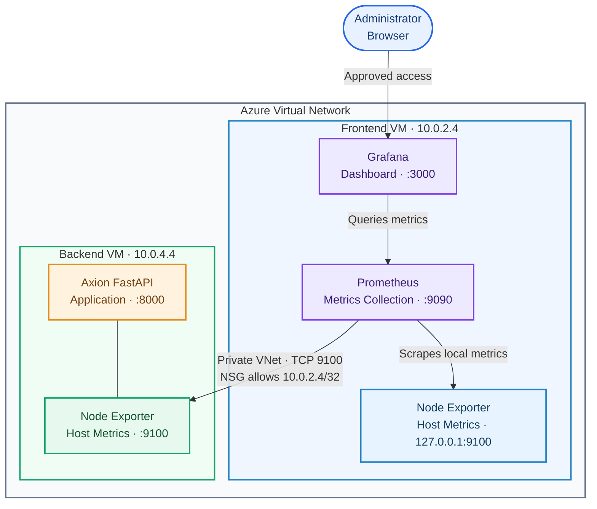

# Axion Infrastructure Monitoring

## Step-by-step Azure implementation guide

**Stack:** Prometheus · Grafana · Node Exporter\
**Operating system:** Ubuntu 24.04 LTS\
**Environment:** Azure Virtual Machines

------------------------------------------------------------------------

## 1. What We Are Building

We will monitor the Linux infrastructure of the Axion application.
Prometheus collects server metrics, and Grafana displays those metrics
in dashboards.

### Architecture

| VM | Private IP | Components |
|---|---|---|
| **Frontend VM** | `10.0.2.4` | React/Nginx, Prometheus, Grafana, Node Exporter |
| **Backend VM** | `10.0.4.4` | FastAPI, Node Exporter |



**Monitoring flow:** Node Exporter exposes host metrics on each VM. Prometheus scrapes both exporters every 15 seconds over the local interface and private VNet. Grafana reads the metrics from Prometheus and presents them in dashboards.

**How it works:** 1. Node Exporter runs on each VM and exposes Linux
system metrics. 2. Prometheus collects those metrics every 15 seconds.
3. Grafana queries Prometheus and displays the metrics in dashboards.

## 2. Prerequisites and Network Security

Before installing the monitoring stack, confirm that both VMs are
running and can communicate over the Azure Virtual Network.

### Required ports

  ------------------------------------------------------------------------
                          Port Service               Required access
  ---------------------------- --------------------- ---------------------
                        `3000` Grafana               Administrator's
                                                     trusted IP or VPN

                        `9090` Prometheus UI         Administrator's
                                                     trusted IP or VPN, if
                                                     direct access is
                                                     needed

                        `9100` Node Exporter         Monitoring traffic
                                                     only; never public

                        `8000` FastAPI               As required by the
                                                     application
  ------------------------------------------------------------------------

### Backend VM NSG rule

Create an inbound rule on the **Backend VM's Network Security Group**:

  Setting            Value
  ------------------ ------------------------------------
  Source             IP Addresses
  Source IP          `10.0.2.4/32`
  Source port        `*`
  Destination        Any
  Service            Custom
  Destination port   `9100`
  Protocol           TCP
  Action             Allow
  Name               `Allow-NodeExporter-From-Frontend`

This allows Prometheus on the frontend VM to scrape the backend
exporter. Do not allow port `9100` from `Any` or the Internet.

------------------------------------------------------------------------

## 3. Configure Node Exporter on the Frontend VM

**Objective:** Install Node Exporter so Prometheus can collect CPU,
memory, disk and network metrics from the frontend VM.

Connect to the frontend VM and run:

``` bash
# Update package lists and install Node Exporter
sudo apt update
sudo apt install -y prometheus-node-exporter

# Open the Node Exporter defaults file
sudo nano /etc/default/prometheus-node-exporter
```

Set the following argument in the file:

``` bash
ARGS="--web.listen-address=127.0.0.1:9100"
```

Save the file using `Ctrl + O`, press `Enter`, then exit with
`Ctrl + X`.

Start the service and verify that metrics are available:

``` bash
# Enable Node Exporter at boot and restart it with the new configuration
sudo systemctl enable prometheus-node-exporter
sudo systemctl restart prometheus-node-exporter

# Confirm the service is running
sudo systemctl status prometheus-node-exporter --no-pager

# Check that the local metrics endpoint responds
curl http://127.0.0.1:9100/metrics
```

You should see metric names such as `node_cpu_seconds_total`,
`node_memory_MemTotal_bytes` and `node_filesystem_size_bytes`.

> The frontend exporter listens on localhost because Prometheus runs on
> the same VM. It does not need to be exposed to the network.

## 4. Install Prometheus on the Frontend VM

**Objective:** Install Prometheus as the central metrics collection and
storage service.

Run these commands on the frontend VM:

``` bash
# Download and extract Prometheus 3.5.0
cd /tmp
wget https://github.com/prometheus/prometheus/releases/download/v3.5.0/prometheus-3.5.0.linux-amd64.tar.gz
tar -xzf prometheus-3.5.0.linux-amd64.tar.gz

# Install the Prometheus server and configuration validation tool
sudo cp prometheus-3.5.0.linux-amd64/prometheus /usr/local/bin/
sudo cp prometheus-3.5.0.linux-amd64/promtool /usr/local/bin/

# Create a dedicated service account and required directories
sudo useradd --no-create-home --shell /usr/sbin/nologin prometheus
sudo mkdir -p /etc/prometheus /var/lib/prometheus

# Set ownership and permissions
sudo chown -R prometheus:prometheus /etc/prometheus /var/lib/prometheus
sudo chown prometheus:prometheus /usr/local/bin/prometheus /usr/local/bin/promtool
sudo chmod 755 /etc/prometheus
```

If the `prometheus` user already exists, `useradd` may report that the
user exists; in that case, continue.

### Configure Prometheus scrape targets

Prometheus needs to know which endpoints to monitor. We will configure
three jobs: Prometheus itself, the frontend VM exporter and the backend
VM exporter.

Open the configuration file:

``` bash
sudo nano /etc/prometheus/prometheus.yml
```

Add this complete configuration:

``` yaml
global:
  scrape_interval: 15s
  evaluation_interval: 15s

scrape_configs:
  # Monitor the Prometheus server itself
  - job_name: "prometheus"
    static_configs:
      - targets: ["127.0.0.1:9090"]

  # Monitor the frontend VM
  - job_name: "frontend-node"
    static_configs:
      - targets: ["127.0.0.1:9100"]

  # Monitor the backend VM through its private IP
  - job_name: "backend-node"
    static_configs:
      - targets: ["10.0.4.4:9100"]
```

Save with `Ctrl + O`, `Enter`, then `Ctrl + X`.

### Create the Prometheus systemd service

Create the service file:

``` bash
sudo nano /etc/systemd/system/prometheus.service
```

Paste:

``` ini
[Unit]
Description=Prometheus Monitoring
Wants=network-online.target
After=network-online.target

[Service]
User=prometheus
Group=prometheus
Type=simple
ExecStart=/usr/local/bin/prometheus \
  --config.file=/etc/prometheus/prometheus.yml \
  --storage.tsdb.path=/var/lib/prometheus \
  --web.listen-address=0.0.0.0:9090
Restart=always
RestartSec=5

[Install]
WantedBy=multi-user.target
```

Save and exit. Then validate the configuration and start Prometheus:

``` bash
# Validate YAML and Prometheus configuration before starting the service
sudo promtool check config /etc/prometheus/prometheus.yml

# Register the service and start it now
sudo systemctl daemon-reload
sudo systemctl enable --now prometheus

# Check service status and HTTP health
sudo systemctl status prometheus --no-pager
curl http://127.0.0.1:9090/-/healthy
```

Expected configuration validation:

``` text
SUCCESS: /etc/prometheus/prometheus.yml is valid prometheus config file syntax
```

Expected health response:

``` text
Prometheus Server is Healthy.
```

The Prometheus web interface listens on `0.0.0.0:9090` to allow approved
remote access. Restrict that access using the frontend VM's NSG.

------------------------------------------------------------------------

## 5. Configure Node Exporter on the Backend VM

**Objective:** Install only Node Exporter on the backend VM. Prometheus
and Grafana remain on the frontend VM.

Connect to the backend VM and run:

``` bash
# Create a dedicated, non-login service account
id node_exporter || sudo useradd --no-create-home --shell /usr/sbin/nologin node_exporter

# Download and extract Node Exporter 1.9.1
cd /tmp
wget https://github.com/prometheus/node_exporter/releases/download/v1.9.1/node_exporter-1.9.1.linux-amd64.tar.gz
tar -xvf node_exporter-1.9.1.linux-amd64.tar.gz

# Install the binary and assign ownership
sudo cp node_exporter-1.9.1.linux-amd64/node_exporter /usr/local/bin/
sudo chown node_exporter:node_exporter /usr/local/bin/node_exporter
```

Create the service file:

``` bash
sudo nano /etc/systemd/system/node_exporter.service
```

Paste:

``` ini
[Unit]
Description=Prometheus Node Exporter
Wants=network-online.target
After=network-online.target

[Service]
User=node_exporter
Group=node_exporter
Type=simple
ExecStart=/usr/local/bin/node_exporter --web.listen-address=0.0.0.0:9100
Restart=always
RestartSec=5

[Install]
WantedBy=multi-user.target
```

Save and exit. Start and verify the service:

``` bash
# Reload systemd and enable Node Exporter at boot
sudo systemctl daemon-reload
sudo systemctl enable --now node_exporter

# Confirm the service and local metrics endpoint
sudo systemctl status node_exporter --no-pager
curl http://127.0.0.1:9100/metrics
```

The backend exporter listens on the VM's network interfaces so the
frontend VM can reach it. The NSG rule from the previous section
restricts that access to the frontend private IP.

## 6. Test Private Connectivity

**Objective:** Confirm that the frontend VM can reach the backend Node
Exporter over the private VNet.

Run this command on the **frontend VM**:

``` bash
curl http://10.0.4.4:9100/metrics
```

If metrics are returned, network connectivity is working.

If the request fails, check the backend Node Exporter service, backend
NSG inbound rule, subnet NSGs and any host firewall. Do not solve
connectivity issues by opening port `9100` to the Internet.

## 7. Connect Grafana to Prometheus

**Objective:** Use Grafana to visualize the metrics stored in
Prometheus.

Install Grafana on the frontend VM using the official APT repository:

``` bash
# Add Grafana's signing key and APT repository
sudo mkdir -p /etc/apt/keyrings
sudo wget -O /etc/apt/keyrings/grafana.asc https://apt.grafana.com/gpg-full.key
sudo chmod 644 /etc/apt/keyrings/grafana.asc
echo "deb [signed-by=/etc/apt/keyrings/grafana.asc] https://apt.grafana.com stable main" | sudo tee /etc/apt/sources.list.d/grafana.list

# Install Grafana and start it automatically
sudo apt update
sudo apt install -y grafana
sudo systemctl enable --now grafana-server

# Verify the service
sudo systemctl status grafana-server --no-pager
```

Open Grafana in your browser:

``` text
http://20.213.139.59:3000
```

Sign in with the initial `admin` credentials if they have not already
been changed. Set a new administrator password when prompted.

### Add Prometheus as a data source

In Grafana:

1.  Open **Connections → Data sources**.

2.  Select **Add data source → Prometheus**.

3.  Set the Prometheus URL to:

    ``` text
    http://127.0.0.1:9090
    ```

4.  Select **Save & Test**.

Grafana and Prometheus run on the same VM, so the localhost URL is
appropriate.

## 8. Verify Targets and Metrics

Open the Prometheus interface:

``` text
http://20.213.139.59:9090
```

In the Prometheus query page, run:

``` promql
up
```

The `up` metric shows whether each scrape target is healthy: - `1` means
Prometheus successfully scraped the target. - `0` means the scrape
failed.

Check each VM separately:

``` promql
up{job="frontend-node"}
```

``` promql
up{job="backend-node"}
```

Both should return `1`.

### Useful infrastructure queries

**CPU usage (%)**

``` promql
100 - (avg by(instance) (rate(node_cpu_seconds_total{mode="idle"}[5m])) * 100)
```

**Memory usage (%)**

``` promql
100 * (1 - node_memory_MemAvailable_bytes / node_memory_MemTotal_bytes)
```

**Root disk usage (%)**

``` promql
100 * (1 - node_filesystem_avail_bytes{mountpoint="/",fstype!~"tmpfs|overlay"} / node_filesystem_size_bytes{mountpoint="/",fstype!~"tmpfs|overlay"})
```

### Import a Grafana dashboard

A useful starting dashboard is **Node Exporter Full**, dashboard ID
`1860`.

1.  In Grafana, open **Dashboards → New → Import**.
2.  Enter `1860` and select **Load**.
3.  Select the Prometheus data source.
4.  Import the dashboard.
5.  Use the instance selector to view the frontend and backend VM
    metrics.

------------------------------------------------------------------------

## 9. Troubleshooting

  -------------------------------------------------------------------------------------------------
  Issue                               First checks
  ----------------------------------- -------------------------------------------------------------
  Backend target is `DOWN`            From frontend, run `curl http://10.0.4.4:9100/metrics`; check
                                      backend NSG and exporter service

  Node Exporter is not running        `sudo systemctl status node_exporter --no-pager` on backend

  Prometheus fails to start           Run
                                      `sudo promtool check config /etc/prometheus/prometheus.yml`

  Grafana cannot query Prometheus     Check Prometheus health and data-source URL
                                      `http://127.0.0.1:9090`

  Grafana page does not open          Check `grafana-server` status and frontend NSG TCP `3000`

  Prometheus UI does not open         Check Prometheus status and frontend NSG TCP `9090`
  -------------------------------------------------------------------------------------------------

Useful service logs:

``` bash
# Prometheus logs
sudo journalctl -u prometheus -n 50 --no-pager

# Grafana logs
sudo journalctl -u grafana-server -n 50 --no-pager

# Backend Node Exporter logs (run on backend VM)
sudo journalctl -u node_exporter -n 50 --no-pager
```

## 10. Final Verification Checklist

-   [ ] Frontend Node Exporter is running and bound to `127.0.0.1:9100`.
-   [ ] Prometheus is running on the frontend VM.
-   [ ] Backend Node Exporter is running.
-   [ ] Backend NSG allows TCP `9100` only from `10.0.2.4/32`.
-   [ ] Frontend VM can retrieve backend metrics from `10.0.4.4:9100`.
-   [ ] Prometheus configuration passes `promtool check config`.
-   [ ] Grafana service is running.
-   [ ] Grafana's Prometheus data source passes **Save & Test**.
-   [ ] Both frontend and backend targets show `UP`.
-   [ ] Grafana dashboard displays metrics from both VMs.
-   [ ] Grafana's default administrator password has been changed.

## 11. Production Notes

-   Keep Node Exporter port `9100` private; never expose it to the
    Internet.
-   Restrict Grafana and Prometheus UI access to a trusted IP range, VPN
    or private access path.
-   Use HTTPS and appropriate authentication for production access.
-   Back up Prometheus configuration and monitoring data.
-   This implementation monitors Linux VM infrastructure. FastAPI
    application metrics, PostgreSQL metrics, alerting and log monitoring
    can be added as separate enhancements.
